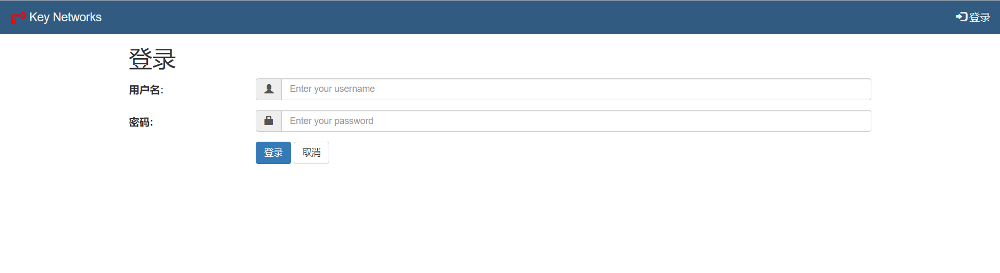
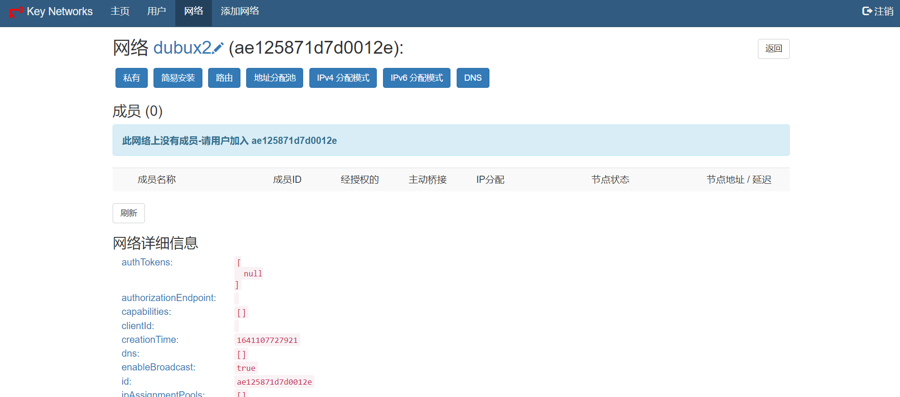
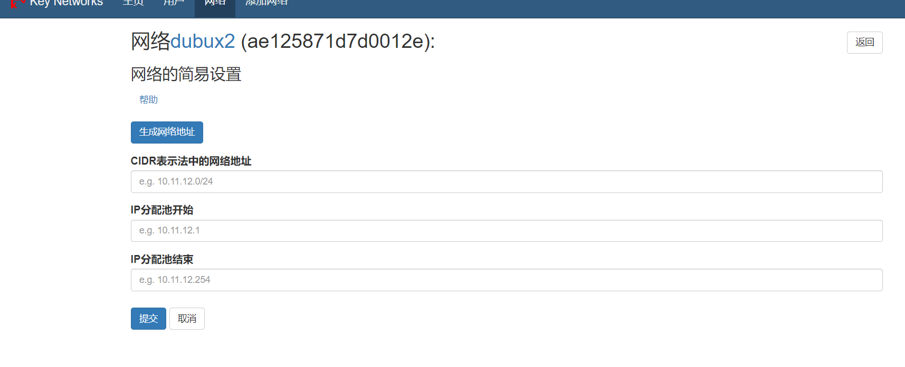
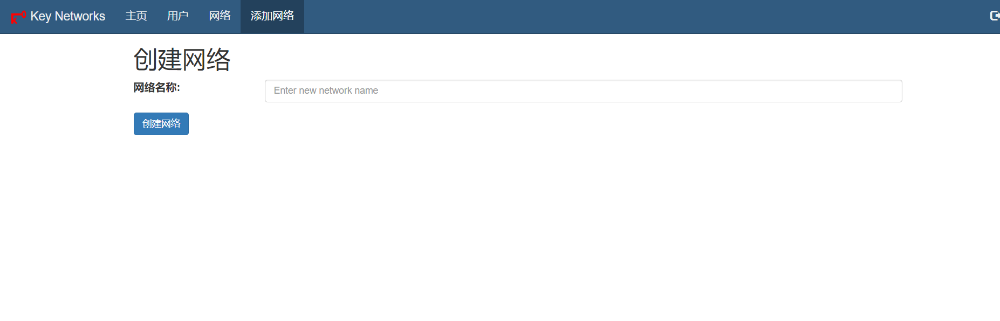
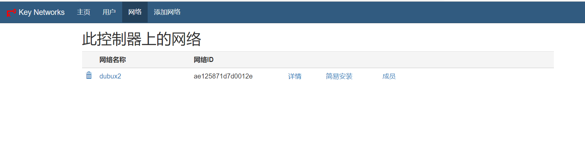

# ztncui Console 1.0.0

新版 Go + Vue 管理界面位于 [`console/`](console/README.md)，支持单管理员、实时刷新、原生策略、可达性检测和响应式亮暗主题。

`Build Console` Actions 构建新版 Linux amd64 可执行包；原有 `Build Install Packages` 保留用于旧版 DEB/RPM 回退，两者互不替代。新版不会自动部署到服务器。

## 旧版界面

ztncui中文版
在官方的仓库 [https://github.com/key-networks/ztncui.git](https://github.com/key-networks/ztncui.git) 基础上进行汉化并打包成可直接安装的linux包，包含deb格式和rpm安装包 在安装zerotier之后直接用命令安装好就是中文其他的配置与网上教程一致; [点击本链接下载发行版](https://gitee.com/opopop880/ztncui/releases)
相关截图：

觉得好用请点击下右上角 Star 你的支持是我维护的动力，欢迎fork或者pull Requests
